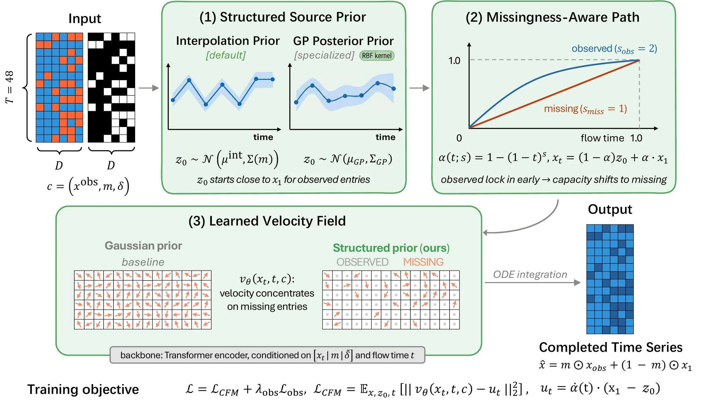
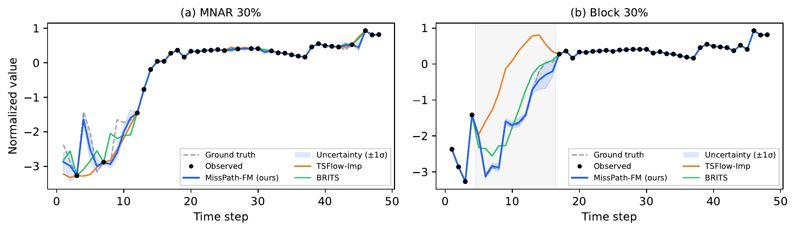
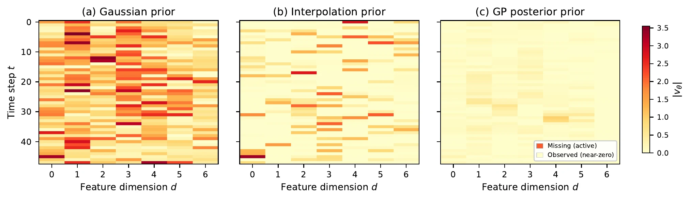

# MissPath-FM: Flow Matching with Structured Priors for Partially Observed Time Series

Official PyTorch implementation of the NeurIPS 2026 paper.

**Genpei Zhang** · University of Wisconsin–Madison

[](https://zgp110.github.io/misspath-fm/) [](https://zgp110.github.io/misspath-fm/) [](https://zgp110.github.io/misspath-fm/static/MissPath-FM_NeurIPS2026.pdf) [](LICENSE)

<p align="center">
  
</p>
<p align="center"><em>
  (1) A structured source prior starts the flow next to the observed signal. (2) A missingness-aware path locks observed
  entries in early. (3) A context-conditioned Transformer predicts the velocity; inference runs 20 Euler steps.
</em></p>

This repository contains the MissPath-FM model and the scripts that reproduce its imputation results and component ablations. No pre-trained weights are shipped: every number is reproduced by training from scratch with the scripts below.

## Overview

Standard conditional flow matching starts from a fixed Gaussian source, so on partially observed data it spends capacity transporting entries whose values are already known. MissPath-FM builds the observation pattern into the transport itself, through three components:

1. **Structured source prior** `p_0(z_0 | c)`. Observed values are interpolated along the time axis, and noise is added with a small variance at observed positions and a larger variance over the gaps, so the flow starts next to the observed signal.
2. **Missingness-aware probability path.** The linear path `x_t = (1 - t) z_0 + t x_1` is replaced by `x_t = (1 - alpha_t) z_0 + alpha_t x_1` with `alpha_t = 1 - (1 - t)^s`, where the speed `s` depends on the mask. Observed entries converge early and missing entries keep the full transport time.
3. **Context-conditioned velocity network.** A Transformer takes `(x_t, t, mask, time_gaps)` and regresses the conditional target `s (1 - t)^(s - 1) (x_1 - z_0)`, with an additional small consistency penalty on observed positions.

## Results

Four datasets (ETTm1, Electricity, Synthetic, PhysioNet 2012) × four missingness mechanisms (MCAR, block, MNAR, irregular) × two missing rates, against eight baselines (SAITS, BRITS, CSDI, GP-VAE, FlowTS, CLWF, TSFlow, PSW-I) under identical splits and masks.

- **Imputation:** best MAE in **29 / 32** settings at `T = 48`, and **45 / 48** overall including `T ∈ {24, 96}`.
- **Forecasting** (`h = 24`, clean and 30%-MCAR histories): best in **6 / 6** settings.
- **Unconditional generation:** best in **8 / 9** metric–dataset combinations, including the best discriminative score on all three datasets.
- **Ablation:** every component helps in every setting. The source prior gives the largest gain under random missingness, the learned flow is what recovers block gaps, and the missingness-aware path adds a further 12–26%.

<p align="center">
  
</p>
<p align="center"><em>
  Qualitative imputation on ETTm1. (a) MNAR 30%: MissPath-FM recovers masked extreme values. (b) Block 30%: inside the
  contiguous gap (shaded), TSFlow diverges and BRITS flattens, while MissPath-FM follows the ground truth.
</em></p>

**Why it works.** With a Gaussian source the velocity field is spread over every entry; with a structured prior the observed entries barely move (up to 15× shorter transport) and the velocity concentrates on the entries that are actually missing.

<p align="center">
  
</p>
<p align="center"><em>
  Velocity magnitude at t = 0.5 on ETTm1 (MCAR 30%) under (a) a Gaussian prior, (b) the interpolation prior, (c) the GP posterior prior.
</em></p>

Full tables are on the [project page](https://zgp110.github.io/misspath-fm/) and in the [paper](https://zgp110.github.io/misspath-fm/static/MissPath-FM_NeurIPS2026.pdf).

## Repository layout

```
.
├── model.py            MissPath-FM: source priors, probability paths, velocity network
├── data.py             Datasets (ETTm1, Electricity, Synthetic, PhysioNet 2012) and
│                       missingness mechanisms (MCAR, block, MNAR, irregular)
├── engine.py           Shared data loaders, training loop, evaluation, checkpoint I/O
├── train.py            Training entry point (train → checkpoint → evaluate)
├── evaluate.py         Evaluation entry point (load a checkpoint → evaluate)
├── requirements.txt
├── LICENSE
└── scripts/
    ├── smoke_test.sh       ~1 min end-to-end check, no external data needed
    ├── run_ettm1.sh        all 8 ETTm1 settings
    ├── run_synthetic.sh    all 8 Synthetic settings
    ├── run_electricity.sh  all 8 Electricity settings
    ├── run_physionet.sh    all 8 PhysioNet settings
    ├── run_main_table.sh   the full main table, sequentially
    └── run_ablation.sh     prior / path / context ablation on one setting
```

## Setup

```bash
git clone https://github.com/zgp110/misspath-fm.git
cd misspath-fm
pip install -r requirements.txt     # torch >= 2.0, numpy, pandas
bash scripts/smoke_test.sh 0        # sanity check on GPU 0 (also runs on CPU)
```

The smoke test trains a small model on the synthetic dataset for 10 epochs, writes a checkpoint, reloads it with `evaluate.py`, and prints MAE and RMSE. It needs no downloaded data.

## Datasets

| Dataset        | Domain     | Shape         | Missingness at evaluation                  |
|----------------|------------|---------------|--------------------------------------------|
| ETTm1          | Energy     | (N, 48, 7)    | imposed: MCAR / block / MNAR / irregular   |
| Electricity    | Energy     | (N, 48, 20)   | imposed: MCAR / block / MNAR / irregular   |
| Synthetic      | Sinusoidal | (2000, 48, 8) | imposed: MCAR / block / MNAR / irregular   |
| PhysioNet 2012 | Clinical   | (N, 48, 36)   | natural, plus hold-out: random / block / MNAR |

The synthetic dataset is generated in-process. The other three expect raw files under `./data/` (override with `--data_dir`):

```
data/
  ETTm1.csv
  electricity.txt
  set-a/                  PhysioNet 2012 set-a, extracted
  set-a.tar.gz            alternative; extracted automatically on first run
```

Sources:

- ETTm1: <https://github.com/zhouhaoyi/ETDataset>
- Electricity (UCI ElectricityLoadDiagrams20112014): <https://archive.ics.uci.edu/ml/datasets/ElectricityLoadDiagrams20112014>
- PhysioNet Challenge 2012: <https://physionet.org/content/challenge-2012/1.0.0/>

Every channel is z-normalised. Electricity keeps the 20 highest-variance channels and subsamples 3,000 windows; PhysioNet is binned into 48 hourly steps over 36 clinical variables. PhysioNet keeps its natural missingness, and evaluation entries are held out among the naturally observed values: uniformly at random (`--mechanism mcar`, reported as "Art." in the paper), in contiguous blocks (`--mechanism block`), or value-dependently (`--mechanism mnar`).

## Training

```bash
python train.py --dataset ettm1       --mechanism mcar  --missing_rate 0.3
python train.py --dataset synthetic   --mechanism block --missing_rate 0.5
python train.py --dataset electricity --mechanism mnar  --missing_rate 0.3
python train.py --dataset physionet   --mechanism mcar  --missing_rate 0.1
```

Each run prints the training loss periodically, writes `checkpoints/<tag>.pt` and `results/<tag>.json`, and reports the final imputation MAE and RMSE on the held-out entries. `<tag>` defaults to `<dataset>_<mechanism>_<rate>_s<seed>` and can be set with `--tag`.

Training draws a random MCAR missing rate per sample from `U[0.1, 0.7]` (RandomRate), so one model covers all evaluation rates. Evaluation always uses the fixed mechanism and rate given on the command line.

## Evaluating a checkpoint

```bash
python evaluate.py --ckpt checkpoints/ettm1_mcar_0.3_s42.pt
```

The evaluation setting is read back from the checkpoint, so the held-out split matches the one used at training time. Any field can be overridden to test transfer to another missingness pattern:

```bash
python evaluate.py --ckpt checkpoints/ettm1_mcar_0.3_s42.pt \
    --mechanism block --missing_rate 0.5 --n_samples 20 --n_steps 20
```

## Reproducing the main imputation table

```bash
bash scripts/run_ettm1.sh        0      # GPU 0, all 8 ETTm1 settings
bash scripts/run_synthetic.sh    0
bash scripts/run_electricity.sh  0
bash scripts/run_physionet.sh    0

bash scripts/run_main_table.sh   0      # everything above, sequentially
```

This covers all 32 settings of the main table: ETTm1, Synthetic and Electricity under 4 mechanisms × 2 rates, plus PhysioNet with random hold-out at 10%, 20%, 30% and 50% and block and MNAR hold-out at 30% and 50%. Reference wall-clock time per setting on a single 24 GB GPU: ETTm1 ≈ 6 min, Synthetic ≈ 8 min, Electricity ≈ 3 min, PhysioNet ≈ 32 min.

## Ablations

Each component can be switched off individually:

| Flag                  | Effect                                                         |
|-----------------------|----------------------------------------------------------------|
| `--prior gaussian`    | standard `N(0, I)` source instead of the interpolation prior   |
| `--path standard`     | linear path instead of the missingness-aware path              |
| `--context mask_only` | the velocity network sees the mask but not the time gaps       |
| `--context gap_only`  | the velocity network sees the time gaps but not the mask       |
| `--context no_mask`   | the velocity network sees only `x_t`                           |

```bash
bash scripts/run_ablation.sh 0 ettm1 mcar 0.3
```

## Default configuration

These defaults are the configuration behind every MissPath-FM number reported in the paper.

| Group     | Setting                                                             |
|-----------|---------------------------------------------------------------------|
| Model     | width 256, 4 layers, 4 heads, FFN 1024, dropout 0.1 (≈3.9M params)  |
| Prior     | interpolation, `sigma_obs = 0.1`, `sigma_miss = 1.0`                |
| Path      | missingness-aware, `speed_obs = 2.0`, `speed_miss = 1.0`            |
| Loss      | CFM + 0.1 × observed-entry consistency penalty                      |
| Optimiser | AdamW, lr 1e-3, weight decay 1e-4, gradient clipping 1.0            |
| Schedule  | 500 epochs, 5-epoch linear warmup, then cosine decay                |
| Batch     | 64                                                                  |
| Training  | RandomRate: per-sample MCAR rate drawn from `U[0.1, 0.7]`           |
| Inference | mean of K = 20 samples, Euler solver with 20 steps                  |

Model selection keeps the state with the lowest *training* CFM loss (checked every 50 epochs); the evaluation split is never used for selection.

## Citation

```bibtex
@inproceedings{zhang2026misspath,
  title     = {MissPath-FM: Flow Matching with Structured Priors for Partially Observed Time Series},
  author    = {Zhang, Genpei},
  booktitle = {Advances in Neural Information Processing Systems},
  year      = {2026}
}
```

## License

This project is released under the MIT License; see `LICENSE`.
